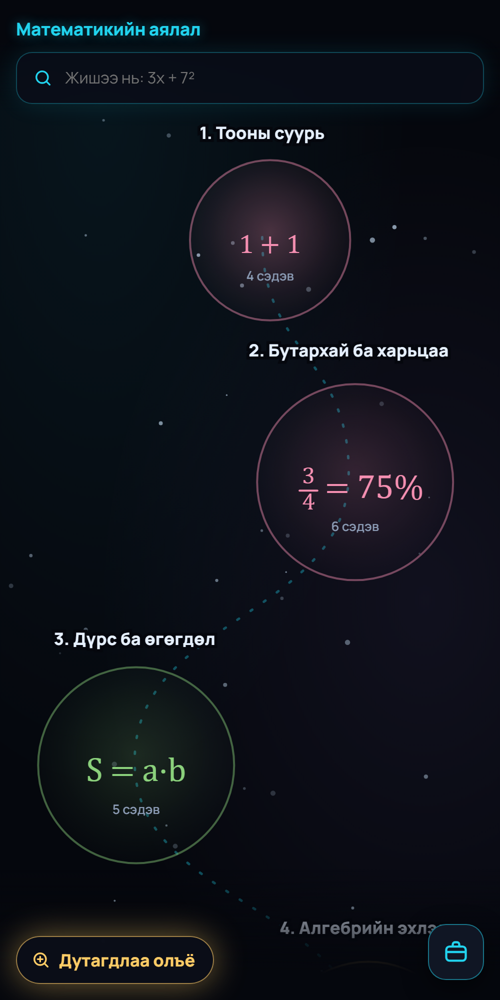
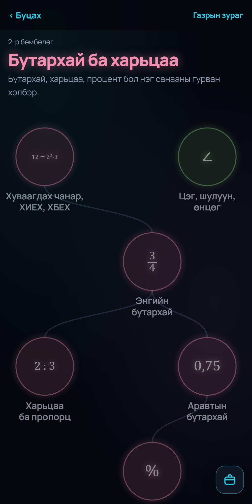
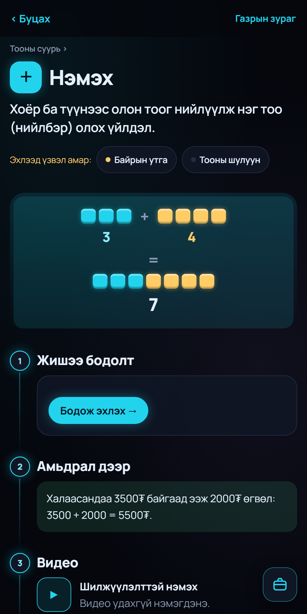
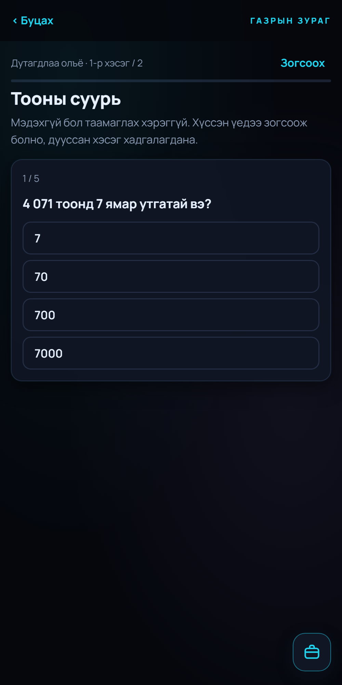

# Математикийн аялал (Math Journey)

A free, phone-first web app that helps Mongolian teenagers who have fallen behind in school math find the exact topic that is blocking them, and climb back from there.

**Live:** https://matematikiin-ayalal.netlify.app (Mongolian interface; installs to the home screen on iPhone and Android)

<p>
  
  
  
  
</p>

## Why I am building it

Classes in Mongolia often have 40 or more students. Topics get skipped in the noise, and teachers rarely have time to help the students who fall behind. The numbers behind that:

- In PISA 2022, Mongolia averaged 425 in math (OECD average 472). Only 49% of 15-year-olds reached the basic level (OECD 69%).
- The average raw math score on the university entrance exam fell from about 26 out of 100 (2020-2023) to 19 in 2025.
- School closures during COVID lasted from January 2020 to September 2021, mostly with TV lessons. The students who were in grades 1-9 then are today's teenagers.

Research also shows the gap is fixable: a student who is behind is usually missing specific earlier pieces, and once those pieces are supplied, they learn at a normal pace. Existing Mongolian resources are organised by school grade or by exam. None of them shows a teenager *which earlier topic* is blocking them. That is what this app does.

## What it does

- **A journey map of school math.** 8 areas ("spheres"), from number basics to calculus, 39 topics in total, ordered by what depends on what rather than by school grade.
- **Find your gap.** An optional, short start check ("Дутагдлаа олъё") tests the basics first and marks which spheres the student already knows. It is never forced, and a student can stop at any point.
- **A dictionary inside the map.** Every term, concept and sign (=, −, ÷, %, √ …) has its own page: a one-sentence definition, a visual, prerequisites, what it unlocks, worked and real-life examples, common mistakes, and a mini test.
- **Learning by doing.** Worked examples for column addition and subtraction run one step per tap, then the student solves a new problem themselves on a digit keypad, with a hint for the exact column they got wrong.
- **Feedback that teaches.** A wrong answer first gets a hint and another try, then the worked step and a link to the topic underneath. Every question has an "I don't know" button, so nobody has to guess. Wrong answers are shown calmly, never in red.
- **Kind progress.** After the start check, known areas light up on the map and the next step is named. Results say what the student has, not what they lack. Coming back after a few days brings a welcome and a 3-question warm-up instead of a broken streak.
- **Search for all of math ("Бүхнийг хай").** The middle tab of an Instagram-style bottom bar. A typed formula is recognised by its shape, so `a²+b²=c²`, `x^2+y^2=z^2` and `c^2=a^2+b^2` all open the Pythagorean theorem: what it is, where it comes from, how to prove it, where it is used and what comes next. When a formula could mean two things, both are offered. The idea map behind it is growing toward all of school math (drafts, checked over time).
- **Math-aware search.** Typing `3x+7^2` shows it the way a textbook prints it and finds the related topics.
- **Tool bag.** A number line, balance scale, fraction bar and coordinate plane are always one tap away.
- **Feedback on every page.** Students can report a mistake or say a part is unclear.

There are no accounts. Progress is stored only on the student's own device.

## How I built it

I built this with an AI coding assistant (Claude Code), and I want to be clear about who did what.

**My part:** the idea and the reason for it; deciding who the app is for; directing the research and choosing what to act on; the product and design decisions (the journey map, the start check, the dictionary-inside-a-map idea, the wording and tone in Mongolian); reviewing every screen; and testing the app on my phone and turning what I found into fixes.

**The AI's part:** writing most of the code, collecting and summarising research sources (which I then checked and decided on), and drafting content for me to review.

Commits made with the assistant are marked `Co-Authored-By: Claude`.

## Status

- A pilot release with a small group of students is planned for October 2026.
- 14 of the topic pages are written so far. The curriculum structure and the Mongolian math terms still need review by a Mongolian math teacher.
- There are no users or learning results to report yet.

## Technical overview

- [Svelte 5](https://svelte.dev) and [Vite](https://vite.dev). The build bundles everything into one self-contained `index.html`, which makes the app fast to load on weak mobile connections and simple to host.
- Installable as a home-screen app (web app manifest and icons).
- Hosted on Netlify. The feedback form uses Netlify Forms, so there is no server or database to run.
- Content lives in plain JSON files, one per topic page, so content can be edited without touching code.
- Security headers (Content Security Policy and others) in `app/public/_headers`.

Run it locally:

```bash
cd app
npm install
npm run dev      # http://localhost:5173
npm run build    # writes dist/index.html
```

## Repository layout

| Path | What is there |
|---|---|
| `app/` | The app: source in `src/`, content in `content/` |
| `research/` | The research behind the design, with every source linked (`left-behind-brief.md` is the summary) |
| `docs/` | Design decisions and screenshots |
| `archive/` | Earlier prototypes, kept to show how the idea evolved |
| `PRODUCT.md` | The original product definition |

## License

Code is released under the [MIT License](LICENSE).
